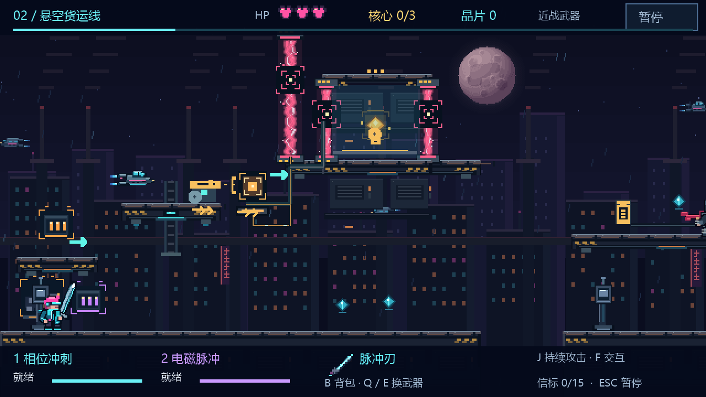
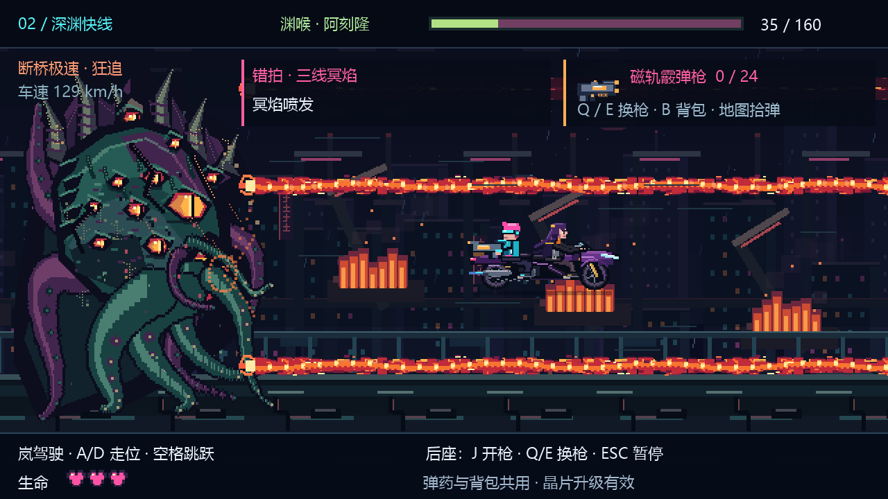
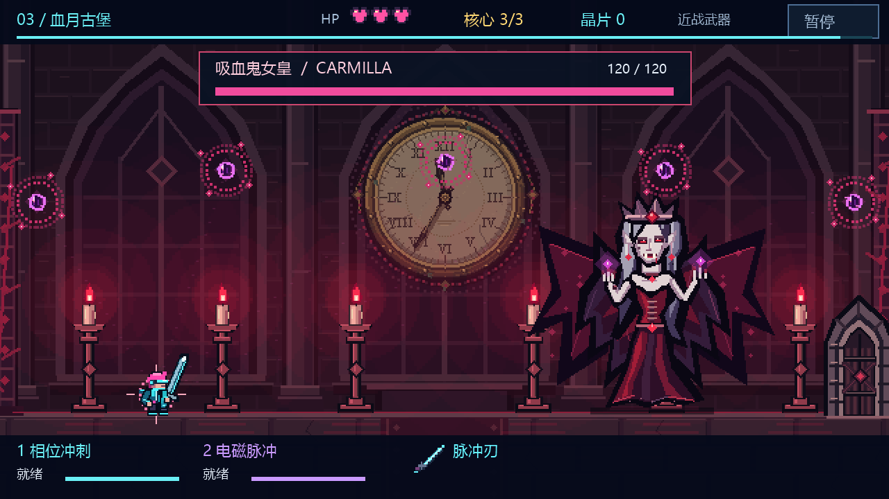

# 霓虹跃迁 · NEON RIFT

赛博朋克像素横版动作冒险 Demo。穿过霓虹街区与悬空货运线，破解核心机关，经历摩托追逐，最终进入血月古堡挑战吸血鬼女皇。

**当前版本：V5.6.9 · 第一章可完整游玩 · Windows**

[下载游戏](https://github.com/fengliuchuan74-crypto/neon-rift/releases/latest) · [操作与玩法说明](游戏说明-v5.6.9.txt) · [设计与迭代记录](设计说明-v5.6.9.md)

## 项目亮点

- **AI 辅助全流程制作**：由创作者主导玩法策划、需求拆解、实机试玩与验收，使用 Codex 辅助实现 C# 程序、像素美术绘制、配乐与演出。
- **3 个关卡、9 种核心解谜**：围绕配重、脉冲联锁、空中冲刺、升降运输、光线与乐谱等机制，结合场景线路、图纹与反馈提供解谜线索。
- **两场特色 BOSS 战**：与伙伴协作的摩托追逐，以及带月光变身、血色护盾和骷髅骑兵的女皇双阶段战斗；通关后解锁独立挑战。
- **战斗与章节成长**：相位冲刺、电磁脉冲、四种武器、有限弹药与晶片商店；搭配角色通讯、摸猫互动和四项成就。
- **持续试玩迭代**：针对平台距离、机关联动、资源分布、受击反馈与输入手感反复调整，并将解谜提示逐步融入环境。

## 游戏画面

升降平台与核心机关：



摩托追逐战：



血月古堡女皇战：



## 下载与运行

1. 打开 [Releases](https://github.com/fengliuchuan74-crypto/neon-rift/releases/latest)，下载 `霓虹跃迁.zip`。
2. 解压到本地文件夹，双击其中的 `霓虹跃迁.exe`。
3. 在主菜单选择第一章开始游玩；游戏支持窗口及 F11 无边框全屏。

运行环境为 **Windows + .NET Framework 4.x**。游戏音乐与必要资源随程序提供，运行无需联网。GitHub 自动提供的 “Source code” 压缩包为源码；直接试玩请下载上述游戏附件。

## 基本操作

| 操作 | 按键 |
| --- | --- |
| 移动 | A / D 或 ← / → |
| 跳跃 / 二段跳 | 空格 / Z / ↑ |
| 相位冲刺 | 1（冷却 10 秒，有效冲刺期间无敌） |
| 电磁脉冲 | 2（冷却 6 秒，可作用于机关） |
| 当前武器攻击 | J / X |
| 切换武器 / 背包 | Q / E；B / Tab |
| 交互 / 通讯继续 | F |
| 返回检查点 / 暂停 | R；ESC |
| 全屏 / 声音开关 | F11；M |
| 菜单选择 / 确认 | 方向键；Enter，也支持鼠标 |

枪械弹药需要在地图中拾取。晶片升级仅在本章有效，重新开始第一章会重置本章成长。

存档位于 `%LOCALAPPDATA%\NeonRift\`。关间进度、已结算晶片、装备与升级会保存；退出后，当前未通关区域从起点重新开始，本关核心与未结算晶片不跨次启动保留。

## 从源码构建

技术栈：**C#、Windows Forms、GDI+、.NET Framework 4.x**。像素画面由代码绘制，序章配乐通过资源嵌入程序，其余配乐由程序合成。

在 Windows 上获取完整源码后，进入仓库根目录执行：

```powershell
powershell -NoProfile -ExecutionPolicy Bypass -File .\build.ps1
.\NeonRift.exe
```

构建脚本使用系统 .NET Framework 的 `csc.exe`，无需 Unity 或 Unreal。请保留根目录 C# 文件、`NeonRift.ico`、`app.manifest` 与 `Assets/prologue.wav`；成功后生成 `NeonRift.exe`。

## 设计与版本记录

- [完整玩法与操作说明](游戏说明-v5.6.9.txt)
- [关卡、战斗与演出设计记录](设计说明-v5.6.9.md)
- [V5.6.9 更新说明](更新说明-v5.6.9.md)

项目保留迭代文档，记录从基础横版原型到完整第一章的功能演进与体验修正。
